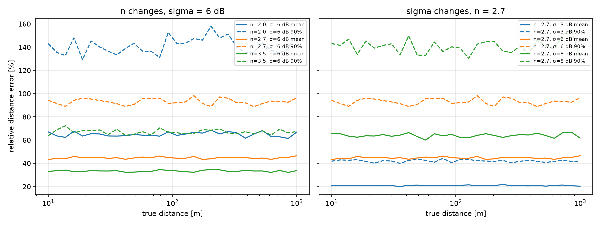
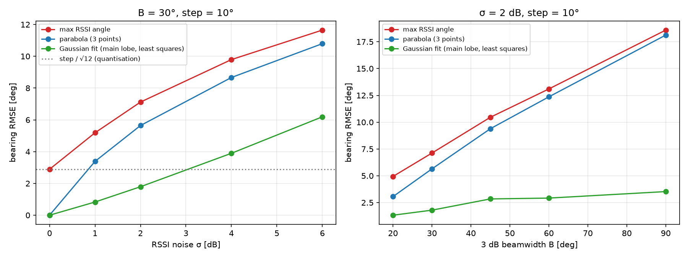
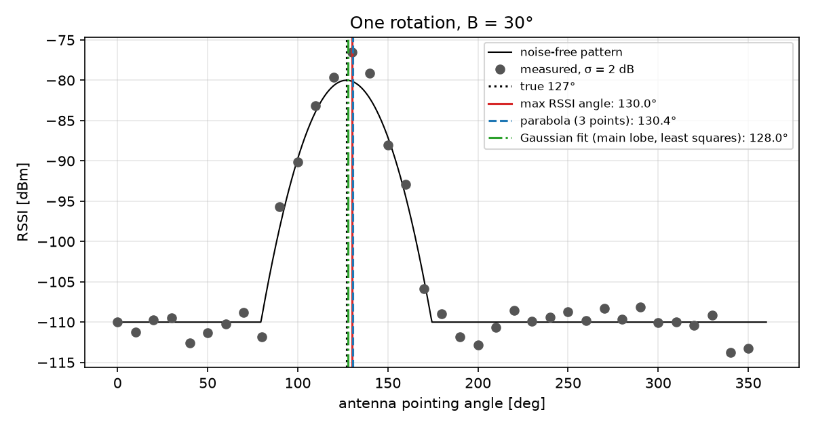
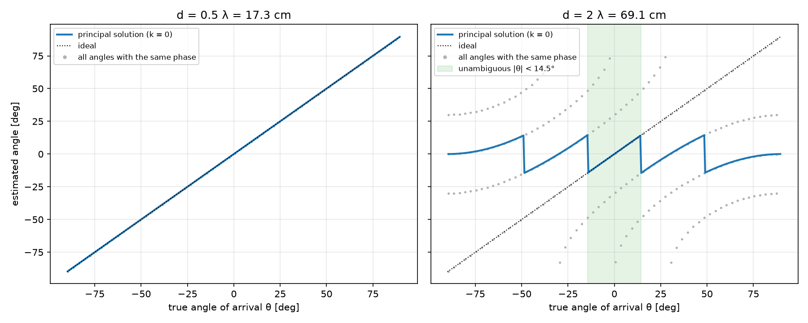
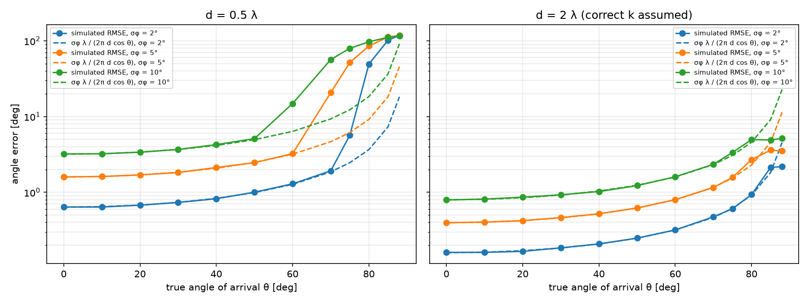
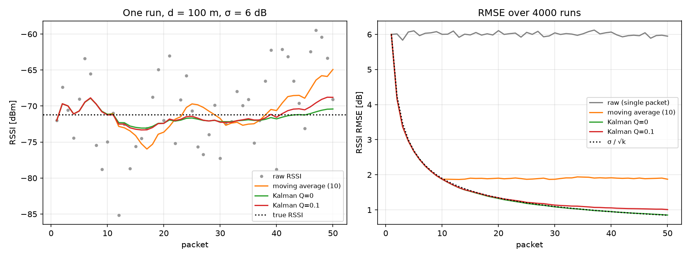
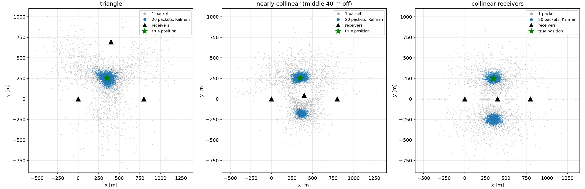
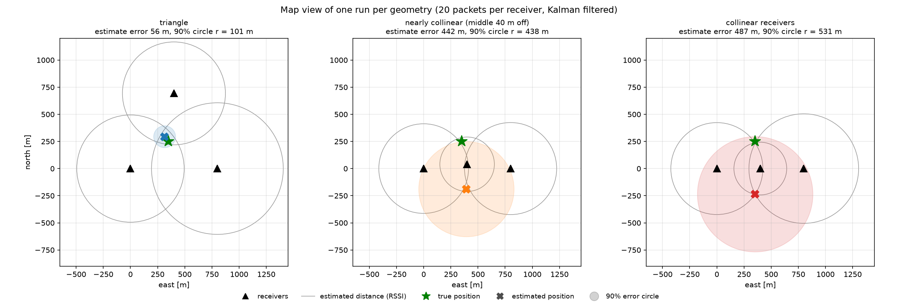

# RSSI ve Faz Farkı ile Yön Bulma: Benzetim Çalışması

[English](README.md) | **Türkçe**

> **Yalnızca benzetim.** Bu depodaki bütün sayılar benzetimden gelir, gerçek radyo ölçümü yapılmadı. Ölçüm adımı (iki LoRa kartıyla mesafeye ve anten açısına göre RSSI) sonraya bırakıldı, bkz. [Gerçek ölçüm](#gerçek-ölçüm).

Arama kurtarmada kaybolan bir kişinin vericisinin yönünü ve mesafesini bir alıcıdan (örneğin hava aracındaki bir alıcıdan) kestirip haritada göstermek gerekir. Bu projede temel yöntemler benzetilip karşılaştırıldı:

1. **Sinyal gücü (RSSI) ile mesafe**: log-distance yol kaybı modeli
2. **Dönen yönlü anten ile yön**: en güçlü RSSI'nın yönü
3. **İki anten arasındaki faz farkı ile yön** (interferometre)

Bunlara ek olarak RSSI Kalman filtresiyle süzüldü, üç alıcıdan konum bulundu (trilaterasyon) ve sonuç haritada gösterildi.

## Ortak ayarlar

| | Değer |
|---|---|
| Frekans | 868 MHz (λ = 0,3456 m) |
| Verici gücü | 14 dBm |
| Referans mesafe d0 | 1 m, RSSI(d0) = P_tx − FSPL(1 m) = −17,21 dBm |
| Tohum | her betikte 0, sonuçlar tekrar üretilebilir |

Birimler her fonksiyonun açıklamasında yazar: mesafe m, güç dBm, kayıp ve gürültü dB, açılar radyan yazmadıkça derece.

## 1. RSSI ile mesafe

**Model.** `RSSI(d) = RSSI(d0) − 10 n log10(d / d0) + X`, `X ~ N(0, σ)` dB cinsinden gölgeleme gürültüsü. Mesafe bu denklemin tersinden bulunur: `d̂ = d0 · 10^((RSSI(d0) − RSSI) / (10 n))`.

Yerine konunca `d̂ / d = 10^(X / (10 n)) = exp(s Z)` çıkar. Burada `s = ln(10) σ / (10 n)` ve `Z ~ N(0, 1)`. Bundan şunlar çıkar:

- hata **çarpımsaldır ve mesafeden bağımsızdır**,
- `s`, `ln(d̂ / d)`'nin standart sapmasıdır; ortalama bağıl hata değildir,
- ortalama bağıl hata `E|d̂/d − 1| = exp(s²/2) · erf(s / √2)`,
- `d̂ / d`'nin medyanı 1, ortalaması `exp(s²/2) > 1`: mesafe ortalamada fazla kestirilir.

`src/yol_kaybi.py` 10 ile 1000 m arasında 30 mesafe tarar, her birinde 2000 gürültü çekimi yapar (`results/yol_kaybi_ozet.csv`):

| n | σ [dB] | Ort. bağıl hata | %90 bağıl hata | std(ln d̂/d) benzetim | s formül | Ort. bağıl hata formül |
|---|---|---|---|---|---|---|
| 2,0 | 6 | %64,9 | %141,3 | 0,691 | 0,691 | %64,8 |
| 2,7 | 3 | %20,8 | %42,0 | 0,255 | 0,256 | %20,9 |
| 2,7 | 6 | %44,7 | %93,1 | 0,513 | 0,512 | %44,6 |
| 2,7 | 8 | %64,0 | %140,5 | 0,683 | 0,682 | %63,7 |
| 3,5 | 6 | %33,3 | %67,1 | 0,396 | 0,395 | %33,2 |



Benzetim ve kapalı form yaklaşık üç hanede uyuşuyor. Model öngördüğü gibi eğriler mesafeye göre düz. **RSSI ile mesafe kabadır:** tipik değerlerde (n = 2,7, σ = 6 dB) tek paket ortalamada %45 yanılıyor, on durumdan birinde %93'ten fazla. Büyük n hatayı *küçültür*: sinyal hızlı düştüğünde aynı dB gürültüsü mesafede daha küçük bir değişime karşılık gelir.

## 2. Dönen yönlü anten ile yön

**Model.** dB cinsinden Gauss biçimli kazanç: `G(θ) = −12 (θ / B)²`, B 3 dB ışın genişliği (`G(B/2) = −3 dB`). Gerçek antenlerde yan ve arka loblar olduğu için kazanç −30 dB'nin altına inmez. Anten 360° boyunca 10° adımlarla döner, her adımda bir gürültülü RSSI kaydedilir. Gerçek yön rastgele seçilir, her durumda 3000 tekrar.

Üç kestirici (`src/yonlu_anten.py`):

- **en yüksek RSSI**: en güçlü ölçümün açısı. Çözünürlük adımla sınırlı.
- **parabol (3 nokta)**: tepe ölçümü ve iki komşusu. dB cinsinden kazanç açının tam karesi olduğu için gürültüsüz durumda tamdır. Doğrusal güçte Gauss uydurmakla eşdeğerdir.
- **Gauss uydurma**: aynı parabol, ama tepenin yaklaşık bir ışın genişliği çevresindeki bütün ana lob ölçümlerine en küçük kareler.

Yön RMSE değerleri, derece (`results/yon_hata.csv`):

| B | σ = 0 dB (tepe / parabol / uydurma) | σ = 2 dB | σ = 6 dB |
|---|---|---|---|
| 20° | 2,86 / 0,00 / 0,00 | 4,94 / 3,05 / 1,32 | 8,03 / 6,72 / 4,38 |
| 30° | 2,89 / 0,00 / 0,00 | 7,12 / 5,64 / 1,79 | 11,65 / 10,79 / 6,19 |
| 45° | 2,90 / 0,00 / 0,00 | 10,46 / 9,39 / 2,84 | 16,45 / 15,91 / 9,66 |
| 60° | 2,89 / 0,00 / 0,00 | 13,10 / 12,36 / 2,92 | 21,60 / 21,19 / 10,11 |
| 90° | 2,87 / 0,00 / 0,00 | 18,59 / 18,13 / 3,53 | 31,49 / 31,20 / 12,94 |



- Gürültüsüz durumda en yüksek RSSI 2,89° verir. Bu, 10° adımın tam nicemleme hatasıdır (adım / √12). İki uydurma yöntemi tamdır.
- Gürültü olunca 3 noktalı parabol, yalnızca üç ölçüm kullandığı için en yüksek RSSI'dan çok az iyidir. En küçük kareler uydurması açık ara en iyisidir: B = 30° ve σ = 2 dB'de 7,1° yerine 1,8°.
- Işın genişledikçe hata büyür. Geniş ışının tepesi daha düzdür, aynı dB gürültüsü görünen tepeyi daha çok kaydırır.



## 3. Faz farkı ile yön (interferometre)

**Model.** Anten aralığı d iken faz farkı `Δφ = 2π d sin θ / λ`, kestirim `θ = arcsin(λ Δφ / (2π d))`. Faz [−π, π) aralığında ölçülür. σφ faz gürültüsü sarmadan önce eklenir. Küçük gürültü için hata: `σθ ≈ σφ λ / (2π d cos θ)`.

**Belirsizlik.** `d > λ/2` ise birden çok açı aynı ölçülen faza düşer (`src/faz_farki.py`, `results/faz_belirsizlik.csv`):

| d / λ | d [cm] | Ortalama uyan açı sayısı | Belirsizliksiz bölge |
|---|---|---|---|
| 0,25 | 8,6 | 1,00 | 180° |
| 0,5 | 17,3 | 1,00 | 180° |
| 1 | 34,6 | 2,00 | 60° |
| 2 | 69,1 | 4,01 | 29° (\|θ\| < 14,5°) |
| 4 | 138,3 | 8,01 | 14° |



Gürültüsüz durumda d = λ/2 her açıyı bulur (en büyük hata 5e-13°). d = 2λ'da ana çözüm açıların %84'ünde yanlıştır. Örneğin 40°'deki bir kaynak, −59,0°, −20,9° ve 8,2° ile aynı fazı verir.

**Gürültü.** σφ = 5° için hata (`results/faz_hata.csv`, her açıda 5000 çekim):

| θ | d = λ/2: RMSE | medyan | formül | ters tarafa sıçrama | d = 2λ, doğru k verilmiş: RMSE | formül |
|---|---|---|---|---|---|---|
| 0° | 1,60° | 1,12° | 1,59° | – | 0,40° | 0,40° |
| 30° | 1,82° | 1,20° | 1,84° | %0 | 0,46° | 0,46° |
| 60° | 3,24° | 2,17° | 3,18° | %0 | 0,80° | 0,80° |
| 70° | 20,7° | 3,15° | 4,65° | %1,7 | 1,16° | 1,16° |
| 75° | 51,8° | 4,20° | 6,15° | %10,8 | 1,58° | 1,54° |
| 80° | 85,4° | 6,11° | 9,17° | %28,4 | 2,70° | 2,29° |
| 85° | 112,2° | 14,1° | 18,3° | %46,4 | 3,60° | 4,57° |



- 60°'ye kadar benzetim formülle uyuşur. Hata 90°'ye doğru `1 / cos θ` ile büyür.
- **Beklenmedik sonuç:** d = λ/2'de 90°'ye yakın açılarda gerçek faz ±π'ye yakındır. Gürültü onu aralığın öbür ucuna sarar, kestirim karşı tarafa sıçrar. 80°'de bu denemelerin %28'inde olur ve RMSE patlar. Formül bunu göstermez.
- d = 2λ dört kat daha hassastır, ama yalnızca belirsizlik çözülürse. Burada doğru k kestiriciye verildi, bu gerçekte mümkün değildir. Hassasiyet ile belirsizlik arasında bir denge kurmak gerekir.
- Sıradan LoRa modülleri faz ölçemez. Bunun için eş zamanlı iki kanallı bir alıcı gerekir (örneğin iki kanallı SDR). Bu adım her durumda yalnızca benzetimdir.

## 4. RSSI'nın Kalman filtresiyle süzülmesi

**Filtre** (`src/kalman.py`). Durum: gerçek RSSI. Model `x_k = x_(k−1) + w`, `w ~ N(0, Q)`. Ölçüm `z_k = x_k + v`, `v ~ N(0, R = σ²)`. Her adım: `P = P + Q`, `K = P / (P + R)`, `x = x + K (z − x)`, `P = (1 − K) P`.

Q = 0 ve P0 = R iken kazanç `K_k = 1 / k` olur, yani filtre bütün paketlerin ortalamasına eşittir. Kod bunu sayısal olarak doğruluyor: en büyük fark 7e-14 dB, 50 paketten sonra `P = R / N = 0,72`.

100 m'de hareketsiz hedef, n = 2,7, σ = 6 dB, 50 paket, 4000 koşu (`results/kalman_ozet.csv`):

| Yöntem | RSSI RMSE [dB] | Ort. mesafe hatası | Medyan | %90 | Ham ölçüme göre düşüş |
|---|---|---|---|---|---|
| Ham (tek paket) | 5,95 | %43,5 | %32,6 | %89,1 | – |
| Hareketli ortalama (10) | 1,87 | %12,8 | %10,8 | %26,2 | %70,5 |
| Kalman Q = 0 | 0,85 | %5,8 | %4,9 | %11,9 | %86,7 |
| Kalman Q = 0,1 | 1,01 | %6,8 | %5,7 | %14,1 | %84,3 |

Kuram: ham 6,00 dB, hareketli ortalama 6 / √10 = 1,90 dB, Kalman Q = 0 için 6 / √50 = 0,85 dB.



Hareketli ortalama penceresi dolunca daha fazla iyileşmez. Q = 0 olan Kalman σ / √k ile iyileşmeyi sürdürür. Küçük bir Q biraz doğruluk kaybettirir, ama filtrenin yavaş değişen bir sinyali izlemesine izin verir.

**Önemli uyarı:** benzetimde gürültü her paket için bağımsız çekilir. Gerçekte hareketsiz bir hedefin gölgelemesi (verici ile alıcı arasındaki engel) paketten pakete aynı kalır. Filtre yalnızca hızlı değişen kısmı (sönümleme, ölçüm gürültüsü) azaltabilir, bu sapmayı gideremez. Gerçek kazanç burada görünenden küçük olacaktır.

## 5. Trilaterasyon ve harita

**Yöntem** (`src/trilaterasyon.py`). Konum `Σ (‖p − p_i‖ − d_i)²` toplamını küçülten noktadır (`scipy.optimize.least_squares`), beş başlangıç noktasından çözülür. Hedef (350, 250) m'de, n = 2,7, σ = 6 dB, 2000 koşu. Mesafeler ya tek paketten ya da alıcı başına Kalman (Q = 0) ile süzülmüş 20 paketten gelir.

Üç alıcı dizilimi:

- üçgen (0, 0), (800, 0), (400, 693)
- neredeyse doğrusal: ortadaki alıcı doğrudan 40 m dışarıda
- doğrusal (0, 0), (400, 0), (800, 0)

Konum hatası, metre (`results/trilaterasyon.csv`):

| Geometri | Paket | Medyan | %90 | RMSE | y < 0 tarafındaki kestirimler |
|---|---|---|---|---|---|
| Üçgen | 1 | 254,5 | 649,5 | 391,4 | %15,6 |
| Üçgen | 20 | 51,7 | 100,7 | 65,9 | %0,0 |
| Neredeyse doğrusal | 1 | 323,9 | 544,3 | 376,3 | %38,7 |
| Neredeyse doğrusal | 20 | 64,0 | 438,4 | 244,1 | %31,2 |
| Doğrusal | 1 | 379,6 | 708,3 | 459,7 | %48,2 |
| Doğrusal | 20 | 439,0 | 531,2 | 362,0 | %51,2 |



- Gürültü yokken üçgen ve neredeyse doğrusal dizilim hedefi tam bulur (hata 1e-9 m).
- Alıcılar doğrusalsa nokta ile doğruya göre aynası (350, −250) **tam olarak aynı maliyeti** verir, veri bunları ayıramaz. Kestirici bu durumda eşit maliyetli çözümlerden birini rastgele seçer. 40 gürültüsüz çözümün 16'sı hedefe, 24'ü aynaya düştü. Süzme işe yaramıyor: hata yaklaşık 500 m'lik ayna uzaklığında kalıyor.
- Ortadaki alıcıyı doğrudan 40 m çıkarmak yetmiyor. Süzmeden sonra da kestirimlerin %31'i yanlış tarafta.
- Üçgende süzme, %90 hatayı 650 m'den 101 m'ye indiriyor.

Kodun ilk sürümü her zaman ilk bulunan çözümü tutuyordu. Başlangıç noktalarının sırası yüzünden bu hep hedefin bulunduğu taraftı ve doğrusal dizilim üçgenden iyi görünüyordu. Eşit maliyetli çözümler arasından rastgele seçmek bunu düzeltti. Yukarıdaki tablo düzeltilmiş koddan geliyor.

**Harita.** `results/harita.html` (folium), her geometri için 20 paketli tek bir koşuyu gösterir: alıcılar, kestirilen mesafe daireleri, gerçek konum, kestirim ve benzetimdeki %90 hata yarıçapıyla çizilen daire. Her geometri ayrı bir katmandır. Yerel metreler **keyfi** bir başlangıç noktası (39,0° K, 35,0° D) etrafında enlem ve boylama çevrilir, gerçek bir arama alanını temsil etmez. Arka plan karoları internet bağlantısı gerektirdiği için aynı koşu arka plansız durağan bir görsel olarak da çizildi (`results/harita.png`):



Bu koşuda üçgen hedefi 56 m ıskalıyor ve hedef 101 m'lik dairenin içinde. Neredeyse doğrusal ve doğrusal dizilimlerin ikisi de alıcıların altındaki ayna çözümünü seçiyor, hedeften 442 m ve 487 m uzakta. Bu dairelerin merkezine gönderilen bir arama ekibi doğrunun yanlış tarafında arardı.

## Gerçek ölçüm

**Yapılmadı.** Yukarıdaki her şey yalnızca benzetimdir. Planlanan ölçüm:

- bir LoRa kartı verici, biri alıcı olarak açık alanda kullanılır,
- 10, 20, 50 ve 100 m'de en az 30'ar paket kaydedilir, mesafeler şeritle ölçülür, sonuçlar `data/` içine CSV olarak (mesafe, RSSI, SNR) kaydedilir,
- o ortam için n ve σ uydurulup benzetimle karşılaştırılır,
- yönlü anten varsa 15° adımlarla RSSI kaydedilip 2. bölümdeki kestiriciler uygulanır.

## Sağlama kontrolleri

`src/saglama.py` proje planındaki koşulları `assert` ile sınar, ilk hatada durur. 28 kontrolün hepsi geçiyor:

- 433, 868 ve 121,5 MHz için dalga boyları,
- FSPL 71,21 dB (868 MHz, 100 m) ve 65,17 dB (433 MHz, 100 m),
- gürültüsüz mesafe, yön, geliş açısı ve konum tam,
- gürültü formülleri benzetimle uyumlu,
- `G(B/2) = −3 dB`,
- d = 2λ ±14,5° dışında belirsiz,
- Q = 0 olan Kalman kümülatif ortalamaya eşit,
- doğrusal alıcılar ayna çözümü üretiyor,
- aynı tohum birebir aynı sonucu veriyor.

## Sınırlamalar

- **Benzetim ölçümün yerini tutmaz.** Çok yollu yayılım (yansımalar), düzensiz anten desenleri, antenler arası bağlaşım, alıcı kalibrasyonu ve donanım hataları modellenmedi.
- **Gölgeleme her paket için bağımsız çekildi.** Gerçekte hareketsiz bir hedef için zamanda ve uzayda ilintilidir, bu yüzden süzme 4. bölümde göründüğünden az işe yarar.
- **RSSI ile mesafe doğası gereği kabadır.** σ = 6 dB'de tek paket yüzde onlarca yanılır, hata mesafeyle orantılı büyür.
- **RSSI ile yön ışın genişliğine ve yansımalara duyarlıdır.** Gauss ana lob ve −30 dB taban idealleştirmedir.
- **Faz yöntemi yalnızca d ≤ λ/2 için belirsizliksizdir.** O zaman bile ±90° yakınında (uç yön) gürültü fazı sardığı için bozulur. Sıradan LoRa modülleri faz ölçemez.
- **Model parametreleri sabittir.** Yol kaybı modeli her alıcı için aynı n ve σ değerlerini kullanır. Gerçek arama alanı homojen değildir.
- **Tek hedef, yalnızca 2B.** Trilaterasyon tek bir sabit hedef konumunu ve düz 2B geometriyi kullanır. Alıcı yüksekliği ve hava aracının hareketi modellenmedi.

## Yeniden üretme

Windows'ta Python 3.12 ile:

```powershell
py -3.12 -m venv .venv
.venv\Scripts\Activate.ps1
python -m pip install -r requirements.txt
```

Sonra:

```powershell
python src\yol_kaybi.py       # bölüm 1
python src\yonlu_anten.py     # bölüm 2
python src\faz_farki.py       # bölüm 3
python src\kalman.py          # bölüm 4
python src\trilaterasyon.py   # bölüm 5 ve results\harita.html
python src\saglama.py         # bütün sağlama kontrolleri
```

Her betik tablolarını ve grafiklerini `results/` içine yazar. Geliştirme makinesinde her betik 2 saniye civarında sürdü; tek istisna `trilaterasyon.py` (yaklaşık 70 saniye: 12.000 konum çözümü, her biri beş başlangıçtan en küçük kareler).

## Klasör yapısı

```
src/        kaynak kodlar
data/       gerçek ölçüm CSV dosyaları (boş: henüz ölçüm yok)
results/    tablolar, grafikler ve harita
```

## Lisans

MIT, bkz. [LICENSE](LICENSE). `results/harita.html` içindeki harita, sokak ve uydu arka plan karolarını Esri'den yükler (atıf haritanın üzerinde görünür). Arka planın görünmesi için internet bağlantısı gerekir.
